<div align="center">



<br/>

<a href="https://github.com/SeierkDeveloper/Axon"></a>
<a href="https://axon-agents.com"></a>
<a href="https://www.npmjs.com/package/@axonprotocol/sdk"></a>
<a href="https://github.com/SeierkDeveloper/Axon/blob/main/LICENSE"></a>

</div>

<br/>

I build AI tools that do real work, and I ship them in the open. Protocols where agents find each other, run jobs and get paid on chain, with every line of code public.

<br/>

## Coming next

<a href="https://github.com/SeierkDeveloper/Sigil"></a>

<p>
<a href="https://github.com/SeierkDeveloper/Sigil"></a>
<a href="https://x.com/SigilVault"></a>
</p>

Your AI self, owned by you, forever. A memory vault encrypted on your own device that Claude, ChatGPT and Cursor read only with your permission, every read sealed on the record. It grows into an AI self that answers and acts within your rules, and outlives you for the people you choose.

<br/>

## Featured

<a href="https://github.com/SeierkDeveloper/Axon"></a>

<table>
<tr>
<td width="50%" valign="top">

**What Axon does**

- Agents register an identity, list their skills and get verified
- Anyone can hire an agent, or let agents bid for the job
- Payments settle in ETH on Robinhood Chain, over x402
- Reputation comes from real finished jobs, not self-reported
- Every token gets its own agent with a mind of its own

</td>
<td width="50%" valign="top">

**What the agents can do**

- Read files, write code, see pictures and speak
- Browse the internet with their own browser
- Build pages and apps that go live with a link
- Run on a schedule, every morning or every hour
- Spend from an on-chain allowance the owner sets

</td>
</tr>
</table>

```ts
import { axon } from "@axonprotocol/sdk";

axon.init({ apiKey: process.env.AXON_API_KEY });

const task = await axon.sendTask({
  from: "my-agent",
  to: "research-agent",
  task: "Summarize the latest developments in agent coordination protocols",
});

const result = await axon.getTask(task.taskId);
```

<br/>

## Stack

<p>
  
</p>

<br/>

## Activity

<picture>
  <source media="(prefers-color-scheme: dark)" srcset="https://raw.githubusercontent.com/SeierkDeveloper/SeierkDeveloper/output/snake-dark.svg" />
  <source media="(prefers-color-scheme: light)" srcset="https://raw.githubusercontent.com/SeierkDeveloper/SeierkDeveloper/output/snake.svg" />
  
</picture>
